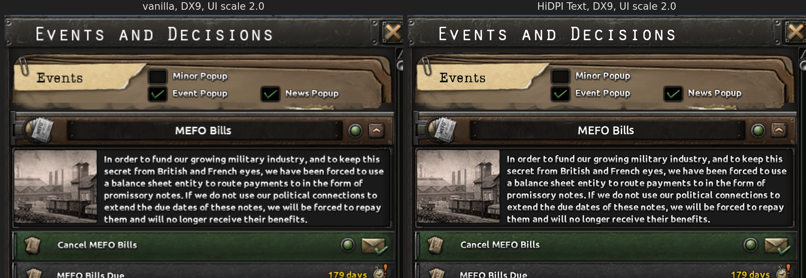
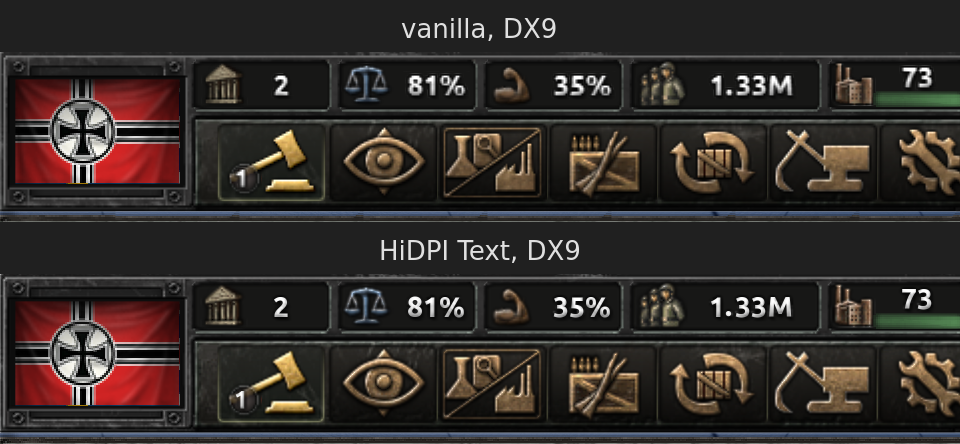

# HiDPI Text for Hearts of Iron IV

Makes HOI4's UI readable on a 4K screen: run the game at native 3840×2160 with the in-game
**UI Scaling (Experimental)** set to **2.0**, and this mod makes UI text render sharp instead of
blurry. It works on both the DirectX 9 (legacy) and DirectX 11 renderers.




## Why the built-in scaling is blurry

HOI4 draws text from bitmap fonts (`gfx/fonts/*.fnt` + a glyph texture). At UI scale 2.0 every
16px glyph is stretched to 32 screen pixels with bilinear filtering, which looks soft.

You can't simply drop in a sharper texture, because the engine computes glyph texture coordinates from
the texture's actual size, not from the `.fnt` header. A 2× texture shows the wrong glyphs.

## What the mod does

1. **2× font atlases.** Every UI font is regenerated at twice the resolution. The `.fnt` metrics
   (advance widths, kerning, line height) are kept exactly as in vanilla, so every window lays out the
   same as before. Only the pixels get sharper.
   - Glyphs are rendered from the real outline fonts where available. The fonts and sizes were found by
     fitting rendered glyphs to the vanilla bitmaps:
     - Ubuntu: most of the UI.
     - URW Gothic, the metric twin of Century Gothic: tooltips.
     - Liberation Sans / Serif: the Arial and Times fonts.
   - Baked-in effects are kept: the metallic gradients, bevels and drop shadows are separated from the
     glyph fill, upscaled, and composited under the crisp fill.
   - Fonts with no free outline available (the Orator headers, the typewriter font and the Garamonds)
     are vectorised from the game's own bitmaps with potrace, then rendered at 2×. This keeps their exact
     look with clean edges.
2. **Patched `gfx/FX/text.shader`.** The generated atlases carry a magic value in their four corner
   texels. The text shader checks for it and doubles the texture coordinates only for those textures.
   Other sprites that go through the same shader, such as the main menu buttons and inline text icons,
   are unaffected. At UI scale 2.0 one atlas texel lands on exactly one screen pixel.
3. **DX9 alignment fix.** At UI scale 2.0 the DX9 renderer samples every UI texture half a screen
   pixel off. That averages the 2× glyphs back down to 1× detail and makes magnified UI art look
   stair-stepped. The patched shaders shift sampling back onto texel centres (DX9 only).
4. **Sharpened UI art.** `text.shader` (non-font textures) and the `buttonstate*.shader` family that
   draws nearly all UI sprites apply AMD FSR 1's RCAS sharpening to the 2× magnified art.

The patched shaders are generated from the installed game's own copies at build time. The mod
overrides `gfx/fonts/*`, `gfx/FX/text.shader` and `gfx/FX/buttonstate*.shader`, so it combines with UI
mods that move windows around. It conflicts only with mods that replace those same files.

## Not covered

- **Tooltips.** The engine renders tooltip contents into an offscreen buffer at 1× (1920×1080 scale)
  and then stretches it 2×, so tooltip text can't use the 2× fonts. No mod can change that; the
  buffer's stretch is only smoothed (DX9) and sharpened, which makes tooltips slightly better than
  vanilla.
- Icons and other UI art are still 1× bitmaps; sharpening helps, but they're not truly high-res.
- Map labels (country, state and arrow text) use separate map shaders and fonts. They're untouched;
  they're world-space and scale with zoom anyway.
- Chinese, Japanese and Korean fonts (`gfx/fonts/{chinese,japanese,korean}`) are untouched.

## Building and installing

Requirements: Python 3 with `numpy`, `Pillow` and `fontTools`; `fc-match` (fontconfig); `potrace`; and
the Ubuntu, URW Gothic (`gsfonts`) and Liberation font packages. A missing outline font isn't fatal:
those fonts are traced from their bitmaps instead and the script prints a warning. Without potrace,
bitmap fonts fall back to a simpler, softer upscaler.

```bash
python3 build_mod.py --install
```

This builds into `./dist/hidpi_text` and copies it to the Proton prefix's HOI4 user directory
(`compatdata/394360/pfx/drive_c/users/steamuser/Documents/Paradox Interactive/Hearts of Iron IV/mod`),
together with a `hidpi_text.mod` descriptor. Use `--install <user dir>` for another location, such as a
native install's `~/.local/share/Paradox Interactive/Hearts of Iron IV`. Use `--game <dir>` if the game
isn't in the default Steam library.

Rebuild after game patches. The script reads fonts and shaders from the installed game, and stops
with an error if a shader changed in a way it doesn't recognise.

## In-game setup

1. Enable **HiDPI Text (2x)** in a playset in the Paradox launcher.
2. In the launcher's game settings, set the resolution to **3840×2160** (fullscreen or borderless).
3. In the in-game settings, set **UI Scaling (Experimental)** to **2.0**. Alternatively, set
   `gui_scale=2.000000` in `settings.txt` in the user directory above.

Uninstall: disable the mod, then delete `mod/hidpi_text` and `mod/hidpi_text.mod`.

## Layout

- `build_mod.py`: entry point; font→outline mapping, mod packaging and install.
- `hidpi/bmfont.py`: BMFont `.fnt` reader/writer and DDS writer.
- `hidpi/ttf.py`: supersampled glyph rasteriser on top of Pillow/FreeType.
- `hidpi/fontgen.py`: per-glyph 2× conversion (alignment, effect separation, compositing) and atlas
  packing.
- `hidpi/trace.py`: potrace-based vectorisation of bitmap glyphs.
- `hidpi/imageops.py`: inpainting, 2× resampling, fallback bitmap upscaling.
- `hidpi/preview.py`: offline before/after renderer for tuning, without starting the game.

## License

MIT; see [LICENSE](LICENSE). The generated mod contains material derived from Hearts of Iron IV
assets, which remain the property of Paradox Interactive; build it yourself from your own install.
